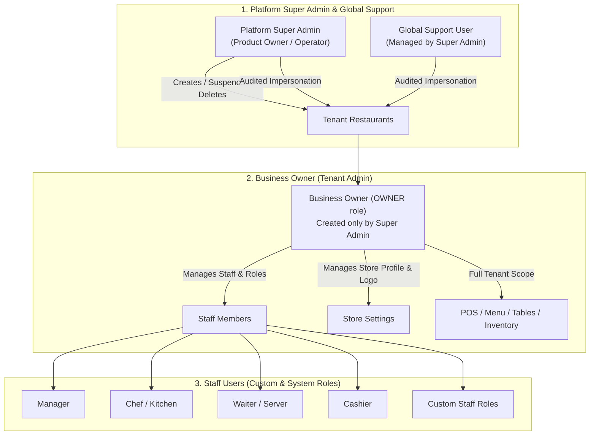

# Multi-Tenant SaaS Architecture & Operations Guide

This document is the definitive guide to the multi-tenant architecture, three-tier access control system, canonical permissions catalogue, platform APIs, tenant endpoints, and database workflows in this Restaurant POS system.

---

## 1. Architecture Overview: Three Access Layers



### Layer 1: Platform Super Admin & Global Support
- **Super Admin**: Product owner who operates the system at `/platform`. The only persona allowed to create, update, suspend, or delete tenant businesses. Can reset business owner passwords, view platform-wide audit logs, and configure the single global support account.
- **Global Support**: A dedicated platform account (`SUPPORT` role) managed solely by the Super Admin. Can enter any tenant for support or troubleshooting via short-lived (2h) audited impersonation tokens.
- **Zero Visibility in Tenants**: Platform users are stored in `PlatformUser`—completely separate from `Employee`. Support users **never appear** in any tenant's staff lists, payroll, attendance, or role management views.
- **Auditing**: Every tenant entry, tenant creation, suspension, and password reset is immutably logged in `PlatformAuditLog`.

### Layer 2: Business Owner (Tenant Admin)
- Created **exclusively** by the Super Admin during business provisioning.
- Fields configured at creation: Business Name, Address, Phone, Business Email, Timezone, Logo URL, Owner First/Last Name, Email, Phone, Password, and PIN.
- Assigned the immutable `OWNER` system role with all 28 permissions.
- Full authority within their restaurant: can create custom staff roles, assign module permissions, hire staff, adjust menu recipes, configure tables, and update business profile/logo.
- **Strict Boundary**: Cannot create other owners or restaurants, cannot access platform routes (`/api/platform/*`), and cannot access any other restaurant's data.

### Layer 3: Staff Users (Granular Module Permissions)
- Created and managed by the Business Owner.
- Assigned system roles (`MANAGER`, `CHEF`, `WAITER`, `CASHIER`) or custom roles created by the owner (e.g. `Shift Lead`, `Bar Operator`).
- Access strictly constrained to granted permissions. For example:
  - `menu.manage`: allows creating, editing, and deleting dishes and recipes.
  - `menu.view`: view-only access (mutations return `403 Forbidden`).
  - `WAITER`: blocked from employee directories, role creation, store settings, backups, and analytics.

---

## 2. Strict Tenant Scoping & Isolation

### Backend Scoping
1. **JWT-Derived Scoping**: Every authenticated tenant request extracts `restaurantId` from the verified JWT via `getAuthenticatedRestaurantId(req)`.
2. **Client Parameter Spoofing Defeated**: Client-supplied query parameters (e.g. `?restaurantId=...`) or body fields are ignored in favor of the token's authenticated claim.
3. **Database Constraints**: Every database query uses `{ where: { restaurantId, ... } }`.
4. **WebSocket Rooms**: Sockets join room `restaurant:<restaurantId>` derived from the verified token. Platform tokens are blocked from tenant socket rooms.
5. **Dual Database Portability**: Prisma models use standard `String` and JSON-string primitives so the exact same schema runs flawlessly on local SQLite (`dev.db`) and cloud PostgreSQL.

### Frontend Scoping
1. **Decoupled Session Storage**:
   - Tenant session: `auth_token`, `auth_refresh_token`, `auth_user`, `support_mode`.
   - Platform session: `platform_auth_token`, `platform_refresh_token`, `platform_user`.
2. **Dynamic UI Filtering**: Sidebar navigation items and action buttons render conditionally based on user permissions or OWNER status.
3. **Route Guards**: Routes wrapped in `<RequirePermission permissions={[...]} />`. Unauthorized attempts redirect to `/forbidden`.
4. **Support Impersonation Banner**: When viewing a tenant via platform impersonation, an amber banner is prominently displayed:
   > 🛡️ **Support Mode Active:** You are viewing [Business Name] as [Owner Name]. [Exit Support Mode ✕]

---

## 3. Canonical Permission Catalogue & System Roles

### Permissions (28 Total)

| Permission Key | Module | Description |
|---|---|---|
| `dashboard.view` | Dashboard | Overview, sales cards, and navigation shortcuts |
| `pos.use` | POS Terminal | Access order terminal and place dine-in/takeaway orders |
| `tables.view` | Tables | View floor plan, occupancy, and table layout |
| `tables.manage` | Tables | Create, edit, combine, split, or arrange floor plan tables |
| `orders.view` | Orders | View active order queue and tickets |
| `orders.create` | Orders | Create new customer orders |
| `orders.update` | Orders | Add items, edit order notes, or change order stage |
| `orders.cancel` | Orders | Cancel, void, or delete orders |
| `orders.discount` | Orders | Apply discounts or adjust line item rates |
| `orders.refund` | Orders | Authorize order returns and refunds |
| `payments.view` | Payments | View register receipts and payment logs |
| `payments.process`| Payments | Collect cash, card, and split bill payments |
| `invoices.view` | Invoices | Browse, view, and print sales invoices |
| `menu.view` | Menu | View dish catalogue and recipes |
| `menu.manage` | Menu | Create, edit, 86, or delete dishes and ingredients |
| `deals.view` | Deals | View combo deals and promotional bundles |
| `deals.manage` | Deals | Create, edit, and toggle combo deals |
| `inventory.view` | Inventory | View stock levels, low-stock warnings, and valuation |
| `inventory.manage`| Inventory| Adjust inventory, add stock, update vendor pricing |
| `kitchen.view` | Kitchen | View Kitchen Display System (KDS) order cards |
| `kitchen.manage` | Kitchen | Bump order items, change station status, route orders |
| `employees.view` | Staff | View staff directory, wage hours, and shift punches |
| `employees.manage`| Staff | Add/edit staff, set pay rates, view & configure PINs |
| `roles.view` | Roles | View tenant roles and assigned permission sets |
| `roles.manage` | Roles | Create, edit, and delete custom staff roles |
| `analytics.view` | Analytics | View revenue reports, peak hours, and product charts |
| `settings.manage`| Settings | Update business name, address, phone, timezone, logo |
| `backups.manage` | Backups | List, export, and manually trigger database backups |

### Default System Roles (Seeded for Every Tenant)

- **`OWNER`**: All 28 permissions. `isSystem: true`, `isOwnerRole: true`. Unconditionally bypasses permission checks. Cannot be modified or deleted.
- **`MANAGER`**: All permissions except `roles.manage`, `settings.manage`, and `backups.manage`.
- **`CHEF`**: `dashboard.view`, `kitchen.view`, `kitchen.manage`, `menu.view`, `inventory.view`, `orders.view`.
- **`WAITER`**: `dashboard.view`, `pos.use`, `tables.view`, `orders.view`, `orders.create`, `orders.update`, `menu.view`, `invoices.view`.
- **`CASHIER`**: `dashboard.view`, `pos.use`, `tables.view`, `orders.view`, `orders.create`, `payments.view`, `payments.process`, `invoices.view`, `menu.view`.

---

## 4. Platform API Reference (`/api/platform/*`)

All platform endpoints require a valid platform JWT signed with `JWT_PLATFORM_SECRET`.

| Method | Endpoint | Required Role | Description |
|---|---|---|---|
| `POST` | `/api/platform/auth/login` | Public | Super Admin / Support login with email & password |
| `POST` | `/api/platform/auth/refresh` | Platform | Refresh platform access token using refresh token |
| `POST` | `/api/platform/auth/logout` | Platform | Revoke platform refresh token and log out |
| `GET` | `/api/platform/me` | Any Platform | Returns current platform user profile |
| `GET` | `/api/platform/restaurants` | Any Platform | List all tenants with owner details, staff count, status |
| `POST` | `/api/platform/restaurants` | `SUPER_ADMIN` | Create new tenant & owner atomically with starter data |
| `PATCH` | `/api/platform/restaurants/:id` | `SUPER_ADMIN` | Update business name, slug, address, or suspend/activate |
| `POST` | `/api/platform/restaurants/:id/reset-owner-password` | `SUPER_ADMIN` | Emergency reset of owner password |
| `POST` | `/api/platform/restaurants/:id/enter` | `SUPER_ADMIN`, `SUPPORT` | Enter tenant in support mode (issues 2h impersonation JWT) |
| `PUT` | `/api/platform/support-account` | `SUPER_ADMIN` | Create or update the single global support user |
| `GET` | `/api/platform/audit-logs` | `SUPER_ADMIN` | Paginated platform audit trail (filterable by tenant/action) |

### Tenant Creation Payload (`POST /api/platform/restaurants`)
```json
{
  "businessName": "Dimlight Cafe & Bistro",
  "address": "Shop 4, Main Boulevard, Sector F",
  "phone": "+92 300 1234567",
  "businessEmail": "contact@dimlightcafe.com",
  "timezone": "Asia/Karachi",
  "logoUrl": "https://example.com/logo.png",
  "ownerFirstName": "Ammar",
  "ownerLastName": "Khan",
  "ownerEmail": "ammar@dimlightcafe.com",
  "ownerPhone": "+92 300 7654321",
  "ownerPassword": "OwnerSecurePassword123!",
  "ownerPin": "1234"
}
```

---

## 5. Tenant Endpoints Reference

All tenant endpoints require a valid tenant JWT signed with `JWT_SECRET`. Platform tokens are rejected with `401`.

### Roles Management (`/api/roles`)
- `GET /api/roles`: List tenant roles (`roles.view`).
- `POST /api/roles`: Create custom staff role (`roles.manage`).
- `PATCH /api/roles/:id`: Update role permissions or description (`roles.manage`).
- `DELETE /api/roles/:id`: Delete custom role (`roles.manage`). Rejects deletion if role is system/owner (403) or has assigned employees (409).

### Store Settings & Logo (`/api/settings/business`)
- `GET /api/settings/business`: Fetch business profile (`settings.manage`).
- `PATCH /api/settings/business`: Update business name, address, phone, email, timezone, or logo (`settings.manage`). Validates logo size (max 2MB) and **strictly blocks SVG** uploads to prevent stored XSS attacks.

### Staff Directory & Time Clock (`/api/employees`)
- `GET /api/employees`: Paginated employee list (`employees.view`). PIN is automatically omitted unless the requester has `employees.manage`.
- `POST /api/employees`: Add staff member (`employees.manage`). Blocks assigning the `OWNER` role. Validates PIN uniqueness within tenant.
- `PATCH /api/employees/:id`: Edit staff member details or deactivate (`employees.manage`). Blocks deactivating or changing role of the Owner account.

### Scoped PIN Login (`POST /api/auth/pin-login`)
Used by staff members at terminal stations:
```json
{
  "pin": "1234",
  "tenantSlug": "dimlight-cafe"
}
```
Requires `tenantSlug` or `restaurantId`. Authenticates the PIN exclusively against active staff in that tenant. A PIN valid in Restaurant A cannot unlock Restaurant B.

---

## 6. Database Migration & Backfill Commands

The repository uses dynamic datasource provider switching with no schema duplication.

### SQLite (Local Development & Offline Electron)
```bash
# Switch schema provider to sqlite and generate Prisma client
npm run prisma:sqlite

# Push schema changes to dev.db
cd apps/backend && npx prisma db push

# Run idempotent multi-tenant backfill migration
npm run db:backfill
```

### PostgreSQL (Cloud Production SaaS)
```bash
# Switch schema provider to postgresql and generate Prisma client
npm run prisma:postgres

# Push or migrate schema on PostgreSQL
cd apps/backend && npx prisma db push

# Run idempotent multi-tenant backfill migration
npm run db:backfill
```

### Automated Acceptance Test Suite
Verifies all 16 multi-tenant security and functional requirements against the live backend:
```bash
npm run test:acceptance
```

---

## 7. Platform User Bootstrapping via Environment Variables

When running `npm run db:backfill`, `npm run db:seed`, or starting the app for the first time, platform users are bootstrapped using environment variables:

```env
# Platform Super Admin Bootstrap (Required in production)
SUPER_ADMIN_EMAIL=superadmin@restaurantpos.com
SUPER_ADMIN_PASSWORD=YourStrongSuperAdminPassword123!
SUPER_ADMIN_NAME="Super Administrator"

# Global Support Account Bootstrap (Required in production)
SUPPORT_EMAIL=support@restaurantpos.com
SUPPORT_PASSWORD=YourStrongSupportPassword123!
SUPPORT_NAME="Global Platform Support"

# Cryptographic Token Secrets (Must be distinct and >= 32 characters in production)
JWT_SECRET=your-secure-tenant-secret-here-at-least-32-chars
JWT_PLATFORM_SECRET=your-secure-platform-secret-here-at-least-32-chars
JWT_REFRESH_SECRET=your-secure-refresh-secret-here-at-least-32-chars

# Public Onboarding (Must be false in production)
ALLOW_SELF_ONBOARDING=false
```

> [!NOTE]
> In development (`NODE_ENV !== 'production'`), if `SUPER_ADMIN_PASSWORD` or `SUPPORT_PASSWORD` are omitted, high-entropy random passwords are automatically generated and written to `.dev-platform-credentials.json` (git-ignored, `0600` permissions). Passwords are never printed to production logs.

---

## 8. Troubleshooting Common Issues

### 1. `403 SELF_ONBOARDING_DISABLED` on `POST /api/auth/onboard`
- **Cause**: By design, public self-registration is disabled so only the Platform Super Admin can provision businesses.
- **Solution**: Create businesses from the Platform Dashboard (`/platform`) or via `POST /api/platform/restaurants`. For local automated testing only, set `ALLOW_SELF_ONBOARDING=true` in `.env`.

### 2. `401 Platform authentication required` or `401 Not a valid platform token`
- **Cause**: Calling platform routes with a tenant token, or calling tenant routes with a platform token.
- **Solution**: Tenant users must use `/api/auth/*`. Platform administrators must log in at `/platform/login` (`/api/platform/auth/login`) and pass their platform token to `/api/platform/*`.

### 3. `403 Business account suspended`
- **Cause**: The business has been deactivated (`isActive: false`) by the Super Admin in the Platform Dashboard.
- **Solution**: In the Platform Dashboard, toggle the restaurant switch back to "Active" (`PATCH /api/platform/restaurants/:id` with `{ isActive: true }`).

### 4. `409 Role cannot be deleted because employees are assigned`
- **Cause**: A custom role cannot be deleted while staff members still hold that role.
- **Solution**: In the Staff Directory (`/employees`), reassign the staff members to another role, then delete the custom role.
